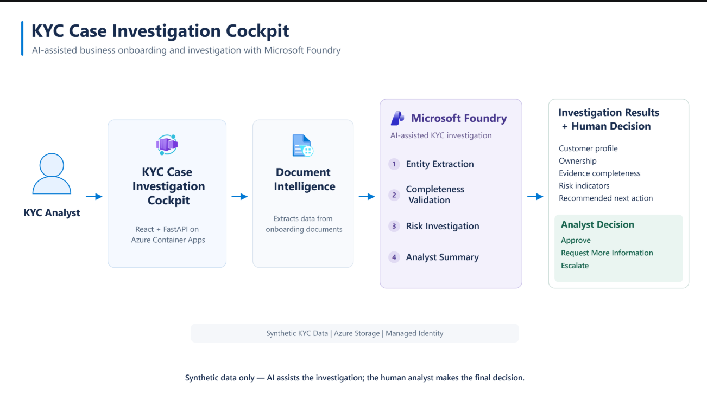
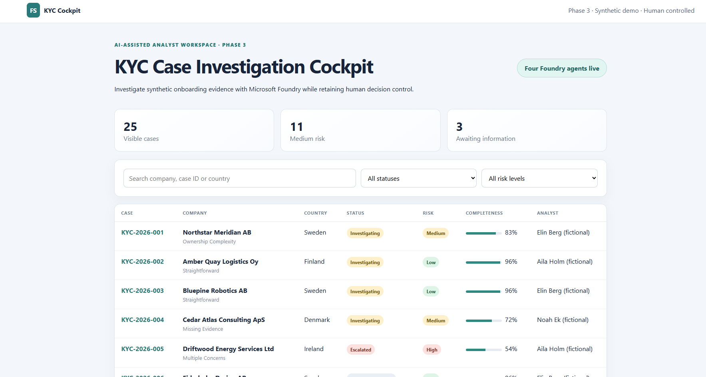

# Financial Services

This folder contains industry-specific solution plays, demos, architecture patterns, and reusable assets for Financial Services customers.

## Suggested Scenarios

- Customer Onboarding & KYC
- Regulatory Compliance
- Risk Assessment
- Fraud Investigation
- Banking Assistants
- Financial Document Intelligence
- AI-assisted Analyst Workflows

## Featured Demo — KYC Case Investigation Cockpit

**AI-assisted Business Onboarding & Investigation with Microsoft Foundry**

KYC Case Investigation Cockpit demonstrates how financial-services analysts can review synthetic onboarding evidence, investigate company and ownership information, identify missing documentation and potential risk indicators, and receive AI-assisted investigation summaries while retaining full control of the final KYC decision.

The solution combines **Azure AI Document Intelligence**, **Microsoft Foundry**, four logical AI agents, and a human-controlled analyst workflow.

### Solution Architecture



### Application Preview



[Explore Project](./kyc-case-investigation-cockpit/README.md) | [Launch Live Application](https://ca-kyc-fs01.salmonpebble-2b6fa79e.norwayeast.azurecontainerapps.io) | [Watch Demo Video](./videos/financial-services-kyc-demo.mp4)

---

### Watch the Demo — KYC Case Investigation Cockpit

See how GitHub Copilot CLI and Squad were used to build and deploy a complete Financial Services AI application using Azure AI Document Intelligence and Microsoft Foundry.

The demo shows:

- synthetic KYC onboarding cases
- document extraction
- entity and ownership analysis
- completeness validation
- risk investigation
- AI-generated analyst summaries
- human-controlled KYC decisions
- audit history

VIDEO_EMBED_PLACEHOLDER

> **Synthetic data only — AI assists the investigation; the human analyst makes the final decision.**

### Reuse the Demo

The project is designed so colleagues can deploy an independent copy into their own Azure subscription.

```powershell
az login
azd auth login
azd env new <environment-name>
azd env set AZURE_LOCATION norwayeast
azd up
```

See the [project README](./kyc-case-investigation-cockpit/README.md) for complete deployment instructions.

### GitHub Copilot CLI + Squad Live Extensions

The project also includes reusable prompts for small customer-driven changes that can be demonstrated live with GitHub Copilot CLI + Squad.

[Live Demo Use Cases & Prompts](./kyc-case-investigation-cockpit/LIVE-DEMO-USE-CASES-AND-PROMPTS.md)
