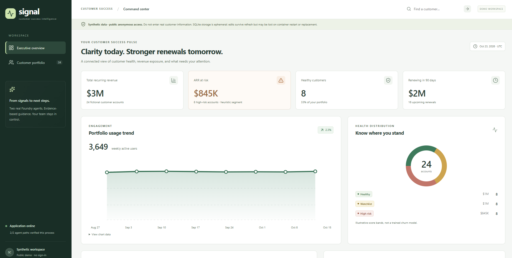
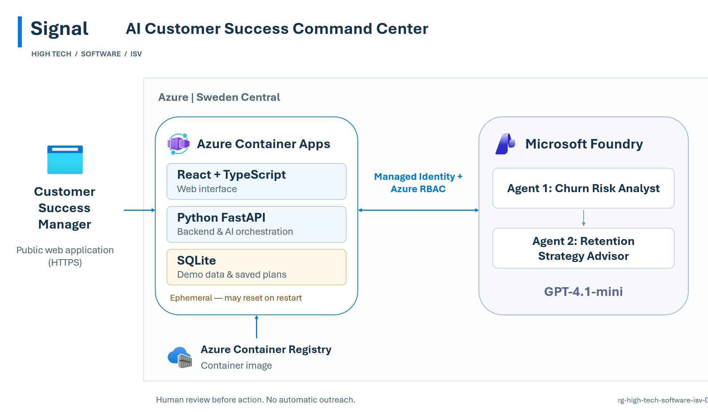

# High Tech / Software / ISV

This folder contains industry-specific solution plays, demos, architecture patterns, and reusable assets for High Tech, Software, and Independent Software Vendor (ISV) customers.

## Suggested Scenarios

- Customer Success & Churn Prevention
- SaaS Product Adoption Intelligence
- Subscription Renewal Management
- AI-Powered Customer Health Monitoring
- Customer Support Intelligence
- Developer Productivity & AI Assistants
- Software Operations & Incident Management
- AI-Assisted Account Planning

---

## Featured Demo — Signal AI Customer Success Command Center

**AI-assisted Customer Health, Churn Risk Analysis & Retention Planning with Microsoft Foundry**

Signal demonstrates how SaaS companies can identify customers at risk, understand the factors driving churn, and generate actionable retention strategies using AI.

Built using **GitHub Copilot CLI with Squad methodology**, the solution demonstrates how a business use case can be transformed into a functional, Azure-hosted AI application.

### Business Challenge

Customer Success teams often rely on disconnected information from product usage, support tickets, customer sentiment, and renewal data.

This results in:

- Fragmented customer insights
- Slow identification of at-risk customers
- Manual churn investigation
- Inconsistent retention strategies
- Limited visibility into account health and actions

### Solution Overview

Signal brings these signals together into a unified Customer Success Command Center.

The application enables users to:

1. Monitor customer health, recurring revenue, and renewal exposure.
2. Explore a portfolio of 24 fictional SaaS customers.
3. Review a comprehensive Customer 360 workspace.
4. Identify customer risks using a Microsoft Foundry AI agent.
5. Generate AI-assisted retention plans and next-best actions.
6. Review, edit, and approve recommendations.
7. Export customer success plans and track activity history.

**AI recommends. Humans decide.**

---

## Solution Architecture

The application runs on Microsoft Azure using a simple architecture designed for a functional customer demonstration.

Key technologies:

- **Azure Container Apps** — Public web application hosting
- **React + TypeScript** — Frontend
- **Python FastAPI** — Backend and AI orchestration
- **SQLite** — Synthetic demo data and saved plans
- **Microsoft Foundry** — AI agent orchestration
- **GPT-4.1-mini** — Model used by the runtime AI agents
- **Azure Container Registry** — Container image storage
- **Managed Identity + Azure RBAC** — Authentication to Foundry

### Microsoft Foundry Agents

**Agent 1 — Customer Churn Risk Analyst**

Analyzes customer adoption, usage trends, support issues, sentiment, and renewal context to explain why an account may be at risk.

**Agent 2 — Retention Strategy Advisor**

Uses the customer context and risk analysis to recommend next-best actions, generate a 30-day retention roadmap, and prepare customer outreach drafts.

---

## Application Preview

Signal provides an executive dashboard with customer health indicators, ARR at risk, renewal exposure, and engagement trends.

Users can drill into individual customer accounts to access AI-powered churn analysis and retention recommendations.

### Explore the Solution

[**Explore Project Source Code**](signal-customer-success-command-center/) |
[**Launch Live Application**](https://ca-high-tech-software-isv-01.gentlebeach-d66a7b07.swedencentral.azurecontainerapps.io) |
[**Live Demo Quick Changes**](signal-customer-success-command-center/LIVE-DEMO-QUICK-CHANGES.md)

---

## Watch the Demo — Signal AI Customer Success Command Center

Discover how GitHub Copilot CLI and Squad were used to build and deploy an end-to-end AI-powered SaaS Customer Success application.

The demonstration covers:

- The business challenge for SaaS customer success teams
- The completed Signal application
- AI-powered churn risk analysis
- Microsoft Foundry retention recommendations
- The Azure solution architecture
- GitHub Copilot CLI and Squad methodology

### Watch the Full Demonstration

See how GitHub Copilot CLI and Squad were used to create Signal, from the initial business use case to a fully deployed Azure AI application.

PASTE_YOUR_GITHUB_ATTACHMENT_URL_HERE

[**Watch or Download the Demo Video**](videos/Signal.demo.mp4)

---

## GitHub Copilot CLI + Squad

This project was implemented using GitHub Copilot CLI with Squad methodology.

The solution was developed in three phases:

**Phase 1 — Azure Infrastructure & Microsoft Foundry**

Provision Azure resources and configure the two runtime AI agents.

**Phase 2 — Application Development & Deployment**

Build the React frontend, FastAPI backend, SQLite persistence, and Foundry integrations. Deploy the public application to Azure Container Apps.

**Phase 3 — Validation & Finalization**

Validate the live application, confirm both AI agents work, and finalize the customer demonstration.

### Live Demo Extensions

Colleagues can demonstrate GitHub Copilot CLI by implementing small enhancements directly into the application.

See the [Live Demo Quick Changes Guide](signal-customer-success-command-center/LIVE-DEMO-QUICK-CHANGES.md).

---

## Important Demo Notes

- Uses fictional SaaS customer data only.
- Public application with anonymous access.
- SQLite is ephemeral; saved changes may be lost when the container restarts or is replaced.
- Customer health scores are illustrative and are not trained churn predictions.
- AI recommendations require human review.
- No customer outreach is automatically sent.
- The solution is intended for demonstrations, not production use.

