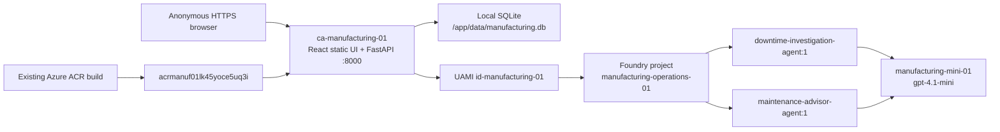

# Architecture — deployed synthetic demo

All existing resources are in **Sweden Central (`swedencentral`)**, in
`rg-manufacturing-01`, subscription `e2d6ac89-1bb7-420c-97fb-a96dea6c0635`,
tenant `fe482aee-20fd-4a0f-8ecd-1db718a7eb6f`. No regional fallback was used.



## Exact current resources

| Component | Existing resource / configuration |
|---|---|
| Container App / Consumption environment | `ca-manufacturing-01` / `cae-manufacturing-01` |
| User-assigned identity | `id-manufacturing-01`; client `87b58205-bb32-45a0-82f9-56545fd08738` |
| Basic container registry | `acrmanuf01lk45yoce5uq3i`; admin disabled |
| Foundry account / project | `ai-manufacturing-01-lk45yoce5uq3i` / `manufacturing-operations-01` |
| Model | `manufacturing-mini-01`: regional Standard capacity **1**, `gpt-4.1-mini` **2025-04-14** |
| Existing **unused** storage | `stmanuf01lk45yoce5uq3i` / Blob container `demo-state`; **not a runtime dependency** |
| Current delivery | ACR build **dt7**, revision **ca-manufacturing-01--0000005** |

Current immutable image:

```text
acrmanuf01lk45yoce5uq3i.azurecr.io/manufacturing-command-center@sha256:67b68e811b7192788b23194047d51e55078002a82e925bf6324ca32028672926
```

## Runtime boundaries

- One public, anonymous, HTTPS-only origin serves SPA routes and `/api/*`;
  `/api/health` checks SQLite, **not** Foundry connectivity. No sign-in, private
  endpoints, VNet, APIM or separate frontend hosting.
- One active revision, **min=max replicas 1**, one Uvicorn worker,
  **0.25 CPU / 0.5 GiB**, target port **8000**.
- `AZURE_CREDENTIAL_MODE=managed_identity` explicitly selects
  `ManagedIdentityCredential`. `AIProjectClient` uses project OpenAI Responses
  with pinned version-1 `agent_reference`; maintenance consumes the saved investigation.
- Strict schemas, nonempty bounded content and actual response/model/agent/token
  attribution are retained. Facts permit up to eight observations; other list
  bounds and two-hypothesis/action limits remain. Generated plans always have
  `approved=false`; a separate explicit human approval record gates state changes.
- SQLite serializes writes with `BEGIN IMMEDIATE`; incident revisions reject stale
  edits. Review, edits, approval, state, activity and jobs commit together.
  Initialization seeds only absent state. **Container restart/replacement MAY LOSE
  everything, including approval/history/jobs and AI admission limits.**
- Both agents share **1 RPM / 1,000 TPM**, at least **65 seconds between starts
  and after completion**, **12 attempts/UTC day**, no queue, zero automatic retries,
  a 16 KB request limit and adaptive **300–450** output tokens. Respect service
  `Retry-After`; limits are not coordinated across replacement filesystems.
- Blob public networking remains **Disabled**; shared keys and anonymous Blob
  access remain disabled. Storage is unused, not deleted or bypassed.
  Azure Policy, existing roles and network configuration were not changed.

Existing Bicep and `scripts\phase2_deploy.py` provide the Azure-side build/delivery
path; Phase 3 reused it only for two necessary narrow fixes. No new services or
architecture changes. Public self-attestation is **not production authorization**.
