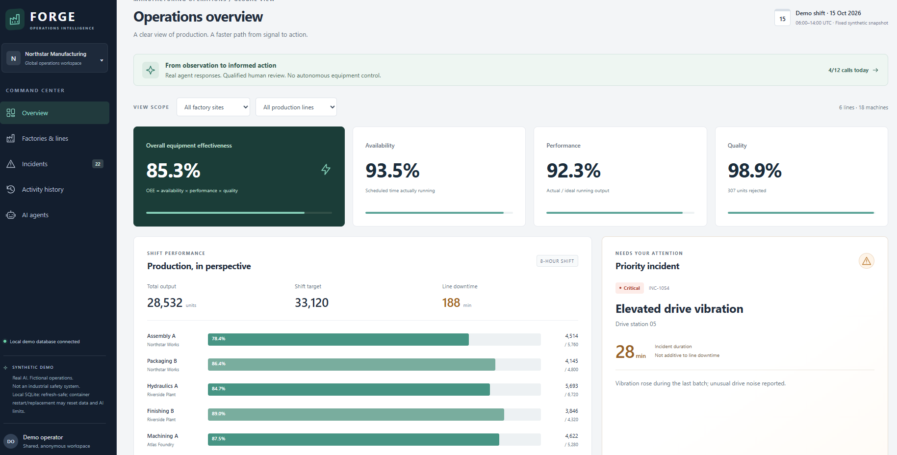
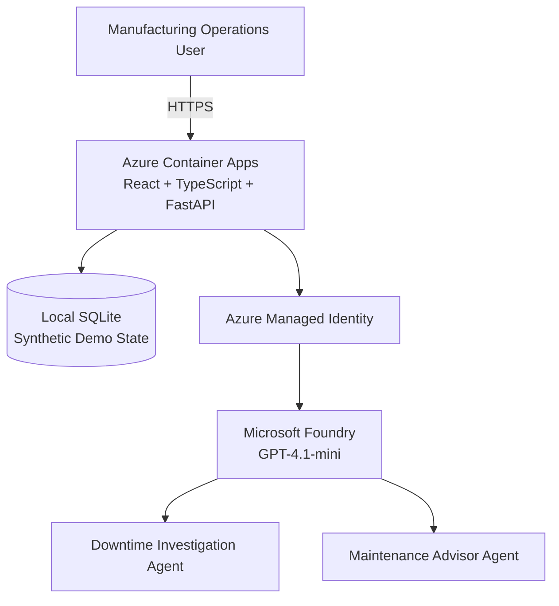

# FORGE — Manufacturing Operations Intelligence

**From Equipment Signals to Informed Action**

An AI-powered Manufacturing Operations Command Center built using GitHub Copilot CLI, Squad, Microsoft Foundry, and Azure.

[**Live Application**](https://ca-manufacturing-01.ambitioussky-87dc9783.swedencentral.azurecontainerapps.io) | [**Watch Demo Video**](./media/manufacturing-demo.mp4)

## Business Challenge

Manufacturing organizations manage multiple factories, production lines, and critical machines.

When equipment shows abnormal behaviour, operations and maintenance teams often need to manually gather machine readings, investigate possible causes, coordinate decisions, and document corrective actions.

This can result in slow investigations, fragmented information, inconsistent decisions, and unplanned downtime.

**FORGE Operations Intelligence** demonstrates how AI can accelerate this process while keeping qualified humans in control.

## Solution Capabilities

- **Operations Overview:** Production KPIs, OEE, availability, performance, quality, and downtime.
- **Factories & Lines:** Equipment health, utilization, maintenance history, and machine alerts.
- **Incident Management:** Prioritized equipment incidents with telemetry and operator observations.
- **AI Downtime Investigation:** Real Microsoft Foundry agent generates evidence-linked hypotheses.
- **AI Maintenance Recommendations:** Second Foundry agent proposes prioritized maintenance actions.
- **Human Review & Approval:** Qualified personnel review, edit, and approve recommendations.
- **Activity History:** Traceable record of AI interactions and human decisions.

## Solution Architecture

## Project Resources

- `frontend/` — React frontend
- `backend/` — FastAPI backend
- `infra/` — Azure infrastructure
- `scripts/` — Deployment scripts
- `DEMO-GUIDE.md` — Demo walkthrough
- `DEMO-EXTENSIONS.md` — Future enhancements

## Important Notes

- Synthetic manufacturing data only.
- AI recommendations require human review.
- No autonomous equipment control.
- Local SQLite data may reset after container restarts.

---

**AI assists. People decide.**
