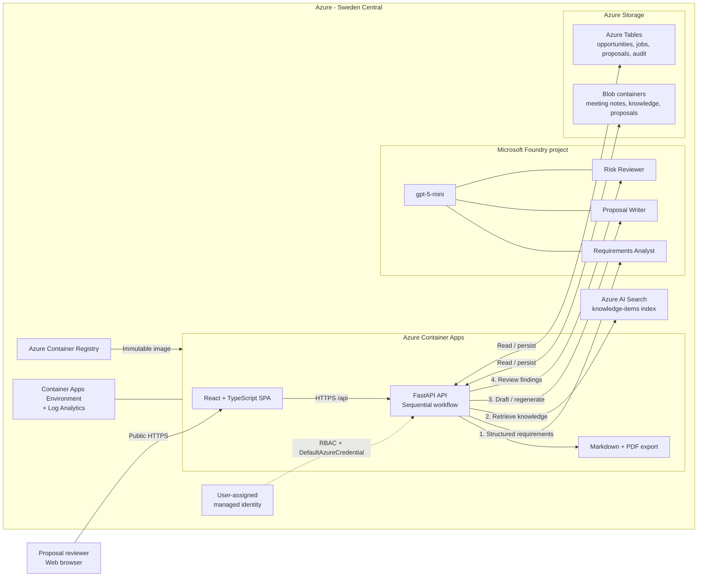

# Professional Services: AI Proposal Factory

> **Demo in a Box for Microsoft Solution Engineers**
> Show how a professional services team can turn customer discovery material and reusable organizational knowledge into a grounded, reviewable proposal with Microsoft Foundry, Azure, and GitHub Copilot CLI + Squad.

[Watch the 4-minute demo](./media/ai-proposal-factory-demo.mp4) · [Launch the deployed demo](https://ca-professional-services-04.graysmoke-ab215499.swedencentral.azurecontainerapps.io/) · [Explore the project](./ai-proposal-factory/) · [Use the live-change playbook](./ai-proposal-factory/LIVE-DEMO-QUICK-CHANGES.md)

## Contents

- [Project overview](#project-overview)
- [Watch the demo](#watch-the-demo)
- [Business challenge](#business-challenge)
- [Solution overview](#solution-overview)
- [Key capabilities](#key-capabilities)
- [Solution architecture](#solution-architecture)
- [Built with GitHub Copilot CLI and Squad](#built-with-github-copilot-cli-and-squad)
- [Repository structure](#repository-structure)
- [How to reproduce the solution](#how-to-reproduce-the-solution)
- [Suggested customer demo flow](#suggested-customer-demo-flow)
- [Cleanup and cost considerations](#cleanup-and-cost-considerations)

## Project overview

AI Proposal Factory is a customer-demo prototype for consulting and professional services organizations. It brings opportunity details, discovery meeting notes, reusable organizational knowledge, proposal drafting, risk review, human approval, and export into one browser experience.

Three managed prompt-style Microsoft Foundry agents structure the customer requirements, draft a 12-section proposal, and identify risks and open questions. Azure AI Search supplies relevant reusable knowledge, while the application keeps the reviewer in control through editing, section regeneration, approvals, risk acknowledgment, exports, and an audit history.

**Business value:** teams can spend less time finding and reassembling existing material, reuse proven knowledge more consistently, surface uncertainty earlier, and focus senior review on the quality of the proposed engagement. The solution accelerates preparation; it does not remove the need for human validation.

## Watch the demo

### [Watch AI Proposal Factory in action (MP4, 4:11)](./media/ai-proposal-factory-demo.mp4)

The recording introduces the manual proposal challenge and the connected AI-assisted workflow, then shows:

- the phased build driven from GitHub Copilot CLI with the Squad custom agent;
- the deployed opportunity and meeting-note experience;
- proposal generation through the Requirements Analyst, Proposal Writer, and Risk Reviewer workflow;
- grounded proposal sections and human review controls;
- the Azure resource group used by the solution; and
- a professionally formatted PDF proposal.

The application shown in the recording runs on the Azure architecture and Microsoft Foundry agent configuration documented below.

## Business challenge

Proposal teams often gather inputs manually from previous proposals, statements of work, meeting notes, case studies, service descriptions, delivery methodologies, project plans, and commercial assumptions. That fragmented process creates several recurring problems:

- lengthy preparation cycles and duplicated effort;
- inconsistent structure, quality, and risk identification;
- limited reuse of organizational knowledge;
- dependence on a small number of senior consultants; and
- weak traceability from source material to proposal content and reviewer actions.

AI Proposal Factory demonstrates a more connected process: organize the available customer evidence, retrieve relevant reusable content, draft a consistent proposal, expose risks separately, and retain explicit human review and approval.

## Solution overview

The implemented workflow is intentionally simple and sequential:

1. A user opens one of eight seeded opportunities and reviews the customer problem, outcomes, scope, stakeholders, constraints, timeline, and effort assumption.
2. The user selects the seeded discovery meeting notes that should inform the proposal.
3. The FastAPI backend creates a persisted generation job and exposes progress while it:
   1. asks the **Requirements Analyst** to return structured requirements;
   2. queries the single Azure AI Search index for relevant organizational knowledge;
   3. sends the opportunity, selected notes, requirements, and retrieved knowledge to the **Proposal Writer**;
   4. asks the **Risk Reviewer** to produce separate structured findings; and
   5. saves the proposal, job state, and audit records.
4. The React application displays the 12 proposal sections, resolved grounding sources, requirements analysis, and risk findings.
5. A reviewer can edit or regenerate an individual section, approve sections, acknowledge or reopen risks, and approve the complete proposal only after all 12 sections are approved.
6. The reviewed proposal can be exported as Markdown or as a branded PDF with source notes and a Risk Review appendix.

The demo uses synthetic data and does not require end-user authentication. Uploading or removing documents, opportunity CRUD, comments, proposal comparison, DOCX export, translation, quality scoring, and advanced version diff are not implemented.

## Key capabilities

| Capability | What is implemented | Business value |
|---|---|---|
| Opportunity dashboard | Eight seeded opportunities with customer, industry, value, duration, status, readiness, and business problem | Gives sales and delivery teams a consistent starting point |
| Opportunity workspace | Business requirements, outcomes, scope, stakeholders, constraints, timeline, effort assumptions, and selectable meeting notes | Consolidates the evidence used to prepare a proposal |
| Three-agent proposal workflow | Requirements Analyst, Proposal Writer, and Risk Reviewer run sequentially through Microsoft Foundry | Separates analysis, drafting, and challenge into focused responsibilities |
| Visible generation progress | The UI polls persisted states for requirements analysis, knowledge search, drafting, risk review, saving, completion, and failure | Makes the AI workflow understandable during a customer demonstration |
| Reusable knowledge retrieval | One Azure AI Search index contains 37 synthetic proposal snippets, case studies, services, methodologies, pricing assumptions, and templates | Demonstrates reuse of organizational knowledge instead of starting from a blank page |
| Knowledge Library | Search and filters by content type and industry | Lets users inspect the corpus used to ground generation |
| Grounded 12-section proposal | Standard sections from Executive Summary through Next Steps, with resolved source details where used | Improves consistency and gives reviewers visibility into reusable sources |
| Human review controls | Edit, save, regenerate one section with optional reviewer direction, and approve each section | Keeps subject-matter experts responsible for the final content |
| Approval gate | Complete proposal approval is blocked until all 12 sections are approved | Makes the final approval step explicit and auditable |
| Structured Risk Review | Severity, category, and status filters; summary counts; mitigations/questions; related-section links; acknowledgments and dispositions | Surfaces uncertainty without silently rewriting the proposal |
| Markdown and PDF export | Downloadable Markdown and branded PDF; PDF includes source notes, page footers, and a Risk Review appendix | Produces portable artifacts for review and customer follow-up |
| Audit history | Generation, editing, regeneration, approval, risk, and export events stored and displayed newest first | Provides simple traceability for the demo workflow |

## Solution architecture

### Component model

- **Frontend:** React 19 and TypeScript, built with Vite. It provides the opportunity dashboard, workspace, Knowledge Library, proposal editor, Risk Review, exports, and audit timeline.
- **Backend:** FastAPI owns the REST API and the sequential proposal workflow. It also serves the compiled React assets and generates Markdown and PDF exports.
- **Hosting:** One public Azure Container App exposes HTTPS on a single URL and runs one container on port 8000. The app uses a user-assigned managed identity and `DefaultAzureCredential`.
- **Microsoft Foundry:** One Foundry project contains one `gpt-5-mini` deployment and exactly three logical prompt agents:

| Agent | Responsibility |
|---|---|
| **Requirements Analyst** | Structures goals, problems, outcomes, scope, stakeholders, constraints, success criteria, timeline, assumptions, open questions, and missing information from the opportunity and selected notes |
| **Proposal Writer** | Produces the 12 ordered proposal sections from the structured requirements and retrieved knowledge; version 2 also supports regeneration of exactly one section |
| **Risk Reviewer** | Returns separate risks, assumptions, dependencies, missing information, and open questions without rewriting the proposal |

- **Azure AI Search:** One keyless `knowledge-items` index supports retrieval for proposal drafting and section regeneration, plus Knowledge Library browsing.
- **Azure Storage:** Blob containers store meeting notes, reusable knowledge, and proposal JSON. Azure Tables store opportunities, generation jobs, proposal metadata, and audit events.
- **Deployment and operations:** Azure Container Registry stores immutable application images. Azure Container Apps Environment hosts the app, and Log Analytics supplies environment logs. Bicep defines the resources and RBAC.
- **Security model:** Foundry, Search, and Storage use public service endpoints with local/shared-key authentication disabled where represented in IaC. Data access uses Microsoft Entra ID, managed identity, and Azure RBAC. This synthetic-data demo has no private networking and no application sign-in.



The backend, not an external orchestration framework, controls the sequence. The Proposal Writer does not query Search directly: FastAPI retrieves relevant items and includes them in the agent input.

The deployed resource inventory and validation evidence are recorded in [`STATUS.md`](./ai-proposal-factory/STATUS.md). The solution deliberately does not use Cosmos DB, Key Vault, API Management, Functions, event buses, a separate export service, or private-networking components.

## Built with GitHub Copilot CLI and Squad

[GitHub Copilot CLI](https://docs.github.com/copilot/how-tos/use-copilot-agents/use-copilot-cli) is an interactive terminal experience for working with code, files, commands, GitHub, custom agents, skills, and subagents through natural-language requests. In this repository, `/agent Squad` selects the project-defined Squad coordinator in [`.github/agents/squad.agent.md`](./ai-proposal-factory/.github/agents/squad.agent.md).

**Squad** is the project's agent collaboration methodology. Instead of asking one general agent to own every concern, a coordinator routes work to a small set of specialists with clear responsibilities:

- **Lead / Architect:** scope, architecture, coordination, and phase-level validation;
- **Full-Stack Engineer:** React, FastAPI, workflow, review experience, and exports; and
- **Azure + AI Engineer:** Bicep, Azure Developer CLI, Foundry, Search, Storage, identity, and deployment.

The authoritative [Squad build brief](./ai-proposal-factory/AI-PROPOSAL-FACTORY-SQUAD-BRIEF-V6-RG04.md) allowed short natural-language prompts because architecture, constraints, success criteria, and stop conditions were already documented. The build used three explicit phases:

| Phase | Natural-language intent | Delivered |
|---|---|---|
| **1. Azure Foundation** | `Implement Phase 1 from the brief.` | Repository skeleton, Bicep/azd foundation, Container Apps Environment, Storage, Search, Foundry project/model, identity/RBAC, and Log Analytics |
| **2. Foundry Intelligence + Core Application** | `Proceed with Phase 2 from the brief.` | Three Foundry agents, React/FastAPI application, single public Container App, seeded data, Search retrieval, proposal generation, progress, and risk findings |
| **3. Human Review + Finalization** | `Proceed with Phase 3 from the brief.` | Knowledge Library, visible grounding, edit/regenerate/approve controls, Risk Review, Markdown/PDF exports, audit history, deployment, and focused smoke validation |

At each boundary, the team validated that phase, updated [`STATUS.md`](./ai-proposal-factory/STATUS.md), and stopped for the next instruction. This demonstrates how a concise prompt plus a strong repository specification can accelerate an end-to-end solution while retaining human decisions, code review, deployment checks, and validation.

For a short customer-facing enhancement after the baseline is deployed, use the tested prompt patterns in the [Live Demo Quick Changes playbook](./ai-proposal-factory/LIVE-DEMO-QUICK-CHANGES.md). Those examples intentionally avoid changing infrastructure, identity, networking, Foundry, Search, or Storage.

## Repository structure

```text
professional-services/
├── README.md                          # This Demo-in-a-Box landing page
├── media/
│   └── ai-proposal-factory-demo.mp4   # 4:11 walkthrough
└── ai-proposal-factory/
    ├── app/
    │   ├── frontend/                  # React + TypeScript application
    │   └── backend/                   # FastAPI API, workflow, adapters, exports
    ├── data/                          # Synthetic opportunities, notes, and knowledge
    ├── docs/
    │   └── architecture.md            # Foundation architecture notes
    ├── infra/
    │   ├── main.bicep                 # Resource-group deployment
    │   ├── main.parameters.json       # Fixed demo parameters
    │   └── modules/                   # Azure resource and RBAC modules
    ├── scripts/
    │   ├── configure_agents.py        # Idempotent three-agent configuration
    │   ├── configure_search.py        # Search index and corpus configuration
    │   ├── seed_demo.py               # Deterministic Storage/Search seed
    │   ├── deploy_phase2.ps1          # Initial application bootstrap
    │   └── deploy_phase3.ps1          # Final deployment and smoke test
    ├── tests/                          # API, unit, and live integration tests
    ├── .github/
    │   ├── agents/                    # Squad coordinator definition
    │   ├── skills/                    # Squad skills
    │   └── workflows/                 # Squad issue/label automation
    ├── .mcp.json                      # Squad state MCP server
    ├── azure.yaml                     # azd service and Phase 3 hook
    ├── Dockerfile                     # React build + FastAPI runtime image
    ├── AI-PROPOSAL-FACTORY-SQUAD-BRIEF-V6-RG04.md
    ├── LIVE-DEMO-QUICK-CHANGES.md
    ├── README.md                      # Original Phase 1 deployment notes
    └── STATUS.md                      # Final deployment and validation evidence
```

## How to reproduce the solution

The project is reproducible for its **fixed demonstration target**, but it is not a turnkey template for an arbitrary subscription as currently checked in. Read the portability note below before running deployment commands.

### Prerequisites

- Git and PowerShell 7.
- [GitHub Copilot CLI](https://docs.github.com/copilot/how-tos/use-copilot-agents/use-copilot-cli), authenticated with access to GitHub Copilot.
- Node.js/npm so the checked-in Squad MCP server can run `npx -y @bradygaster/squad-cli@insider state-mcp`.
- Azure CLI and Azure Developer CLI (`azd`), both authenticated to the intended tenant.
- Python 3.11 or later. The deployment scripts invoke the Azure SDK configuration tools and the live smoke test.
- An existing Azure resource group in Sweden Central.
- Permission to deploy the represented resource types, create role assignments, and—where the tenant policy applies—create the narrowly scoped Storage policy exemption.
- Availability and quota for the represented `gpt-5-mini` Global Standard deployment in Sweden Central, plus quota for Azure AI Search, Container Apps, Container Registry, Storage, and Log Analytics.

The Bicep deployment grants the signed-in deployer the Storage Blob Data Contributor, Storage Table Data Contributor, Search Index Data Contributor, and Search Service Contributor data-plane roles. The runtime managed identity receives the Blob, Table, Search, Foundry, model, and ACR pull roles it needs.

<details>
<summary><strong>1. Clone the repository and prepare Python</strong></summary>

```powershell
git clone https://github.com/microsoft/github-vteam-industry-demos.git
Set-Location .\github-vteam-industry-demos\industries\professional-services\ai-proposal-factory

python -m venv .venv
.\.venv\Scripts\Activate.ps1
python -m pip install -e ".\app\backend[dev]" requests
```

`requests` is required by `tests\integration\live_smoke.py`; it is not currently declared in the backend development extras.

</details>

<details>
<summary><strong>2. Load GitHub Copilot CLI and Squad</strong></summary>

Start Copilot from the project directory so it discovers the repository's custom agent, skills, instructions, and MCP configuration:

```powershell
copilot
```

Inside Copilot CLI:

```text
/env
/agent Squad
```

Use the three phase prompts from the previous section if the goal is to replay the natural-language build story. If the goal is only to deploy the finished source, continue with the Azure steps below.

</details>

<details>
<summary><strong>3. Confirm the deployment target and portability guards</strong></summary>

The checked-in automation intentionally protects the original live-demo environment:

| File | Fixed value or assumption |
|---|---|
| `azure.yaml` | Resource group `rg-professional-services-04` |
| `infra/main.parameters.json` | Sweden Central, naming stem `professional-services-04`, Foundry project `proj-professional-services-04` |
| `scripts/deploy_phase2.ps1` and `scripts/deploy_phase3.ps1` | Exact original subscription ID, resource group, and region |
| `scripts/configure_agents.py` | Foundry endpoint must end in `/api/projects/proj-professional-services-04` |
| `infra/main.bicep` | Tenant-specific Storage policy assignment ID used by the narrow policy exemption |

For the original target, use the commands in the next steps unchanged. For a deployment in **your own Azure environment**, first review and deliberately adapt all values and safety guards above, confirm the target tenant's policy assignment, and validate model availability. The repository does not currently contain a verified one-command path for an arbitrary subscription; changing only the `azd` environment values is not sufficient.

</details>

<details>
<summary><strong>4. Authenticate and provision the Azure foundation</strong></summary>

```powershell
az login
azd auth login

az account show
az group show --name rg-professional-services-04

$env:AZURE_PRINCIPAL_ID = az ad signed-in-user show --query id -o tsv

azd env new
azd env set AZURE_LOCATION swedencentral
azd env set AZURE_RESOURCE_GROUP rg-professional-services-04
azd env set AZURE_PRINCIPAL_ID $env:AZURE_PRINCIPAL_ID

azd provision
```

This provisions the foundation represented by Bicep: managed identity and RBAC, Log Analytics, Container Apps Environment, Storage, Search, Foundry account/project, and the model deployment. Confirm that the active subscription and existing resource group are correct before provisioning.

</details>

<details>
<summary><strong>5. Bootstrap the application, then deploy the final phase</strong></summary>

The Phase 3 script expects the Container App to exist. On a fresh foundation, run the Phase 2 script first to create the registry and initial Container App, configure the agents and index, build the image, and seed data:

```powershell
.\scripts\deploy_phase2.ps1 -SkipSmokeTest
```

Then deploy the final immutable Phase 3 image and run the focused live validation:

```powershell
.\scripts\deploy_phase3.ps1
```

For an existing deployment that already contains the Container App, the supported final contract is:

```powershell
azd up
```

`azure.yaml` runs Bicep provisioning and then invokes `scripts\deploy_phase3.ps1`. Do not use `azd up` as the first command against a fresh foundation without first satisfying the Phase 3 script's existing-Container-App check.

</details>

<details>
<summary><strong>6. Validate the deployment</strong></summary>

The final deployment script runs the live smoke test automatically. To rerun it:

```powershell
python tests\integration\live_smoke.py `
  --base-url https://<your-container-app-fqdn>
```

For a lightweight health check:

```powershell
Invoke-RestMethod https://<your-container-app-fqdn>/api/health
```

Expected response:

```json
{
  "status": "ok",
  "service": "ai-proposal-factory"
}
```

Also confirm:

- the homepage shows the synthetic-data banner and seeded opportunities;
- the Knowledge Library returns the seeded corpus;
- Microsoft Foundry contains exactly the three expected logical agents;
- one selected opportunity and its meeting notes generate a 12-section proposal;
- grounding sources and risk findings are visible;
- editing, one-section regeneration, approvals, Markdown/PDF exports, and audit history work.

The complete validated state is documented in [`STATUS.md`](./ai-proposal-factory/STATUS.md).

</details>

## Suggested customer demo flow

The following sequence fits a 5–10 minute presentation.

| Time | Show | Message to emphasize |
|---|---|---|
| 0:00–1:00 | Frame the manual process or play the opening of the [demo recording](./media/ai-proposal-factory-demo.mp4) | Proposal work is often fragmented across customer notes and reusable delivery assets |
| 1:00–2:00 | Open the opportunity dashboard and select an opportunity | The experience starts with structured customer context and synthetic opportunity data |
| 2:00–3:30 | Review the brief, select meeting notes, and choose **Generate Proposal** | Three focused agents collaborate through a backend-controlled workflow; progress remains visible |
| 3:30–5:00 | Navigate the 12 sections and expand grounding sources | Azure AI Search helps reuse organizational knowledge, while source details remain visible to the reviewer |
| 5:00–6:30 | Edit one section, regenerate another with an instruction, and approve a section | AI accelerates drafting, but people remain responsible for refinement and approval |
| 6:30–7:30 | Open Risk Review, filter findings, and acknowledge one with a disposition | Risks, assumptions, dependencies, and questions are challenged separately rather than hidden in the draft |
| 7:30–8:15 | Show audit history and export Markdown or PDF | Reviewer actions and outputs are durable and demonstrable |
| 8:15–9:00 | In Microsoft Foundry, show the project, `gpt-5-mini`, and the three logical agents; optionally show Search and Storage in Azure | The solution uses a deliberately small, understandable Azure architecture |
| 9:00–10:00 | Open GitHub Copilot CLI, select `/agent Squad`, and use a small prompt from the [live-change playbook](./ai-proposal-factory/LIVE-DEMO-QUICK-CHANGES.md) | Natural-language development can accelerate a visible change when specialists, guardrails, and validation are already defined |

For a live code change, rehearse the full sequence and deployment beforehand. The playbook recommends small frontend-only changes such as an industry filter or opportunity search and explicitly protects the working Azure and AI architecture.

## Cleanup and cost considerations

Deploying this solution consumes billable Azure services, including Microsoft Foundry/Azure AI Services model usage, Azure AI Search, Azure Container Apps, Azure Container Registry, Storage, and Log Analytics. Charges depend on region, SKU, model token usage, build frequency, retained images/logs, and how long the environment remains deployed. Appropriate subscription permissions, service availability, and quota are required.

The repository does **not** include a cleanup script or an `azd down` workflow. If you created a dedicated resource group for your adapted copy and have confirmed that it contains no shared resources, remove the group through Azure:

```powershell
az group delete --name <your-dedicated-resource-group> --yes --no-wait
```

Do not run that command against `rg-professional-services-04` unless you own the original demo environment and have confirmed that the entire group can be deleted. For a shared resource group, resource-by-resource cleanup requires operator confirmation; use the nine-resource inventory in [`STATUS.md`](./ai-proposal-factory/STATUS.md) as the verified baseline.
