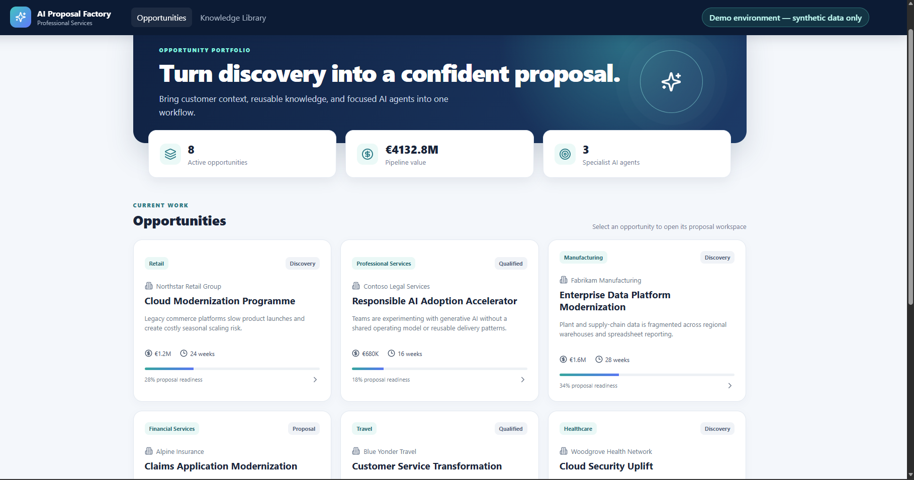

# Professional Services

This folder contains industry-specific solution plans, demos, architecture patterns, and reusable AI assets for Professional Services organizations.

## Suggested Scenarios

- AI-Powered Proposal Generation
- Statement of Work Automation
- Consulting Knowledge Management
- Project Risk Assessment
- AI-Assisted Project Planning
- Delivery Estimation and Scoping

## Featured Demo — AI Proposal Factory

**AI-assisted proposal generation with Microsoft Foundry agents and human oversight**

AI Proposal Factory helps Professional Services teams turn customer discovery requirements and reusable organizational knowledge into structured, customer-ready proposals.

The solution uses three specialist Microsoft Foundry agents to analyze requirements, draft grounded proposal content and identify risks, while keeping consultants responsible for review and approval.

## Solution Architecture

## Application Preview

[Explore Project](./ai-proposal-factory/) | [Launch Live Application](https://ca-professional-services-04.graysmoke-ab215499.swedencentral.azurecontainerapps.io/) | [Watch Demo Video](./videos/Professional-Services-Demo.mp4)

---

## Watch the Demo — AI Proposal Factory

See how GitHub Copilot CLI and Squad were used to build and deploy a complete Professional Services AI application on Microsoft Azure, including three Microsoft Foundry agents.

https://github.com/user-attachments/assets/3c3a9fcc-9fc5-4eea-a985-cc5c3e513fa5

[Open Demo Video](./videos/Professional-Services-Demo.mp4)

---

## Built with GitHub Copilot CLI + Squad

The application was developed using a multi-agent development methodology with three specialist roles:

- **Lead / Architect:** Architecture and coordination.
- **Full-Stack Engineer:** React, FastAPI and application development.
- **Azure + AI Engineer:** Azure infrastructure, Foundry agents and deployment.

The implementation followed three phases:

1. Azure Infrastructure
2. Application + AI Integration
3. Human Review, Exports and Final Validation

**From business requirements to a deployed end-to-end AI application using GitHub Copilot CLI + Squad.**

> Demo environment — synthetic data only.

## Resources

- [Project Source Code](./ai-proposal-factory/)
- [Azure Architecture](./ai-proposal-factory/docs/architecture/)
- [Demo Video](./videos/Professional-Services-Demo.mp4)
- [Live Application](https://ca-professional-services-04.graysmoke-ab215499.swedencentral.azurecontainerapps.io/)

