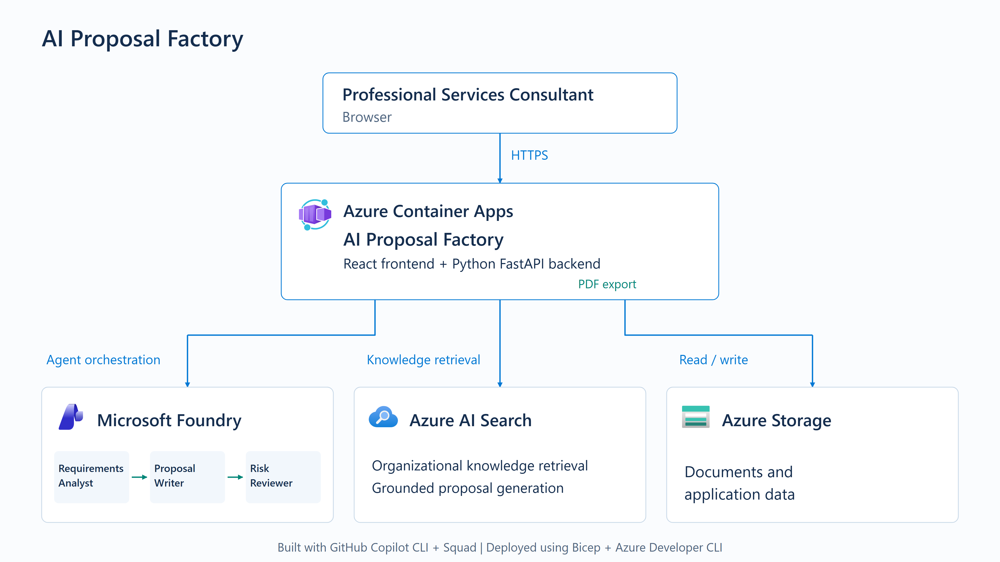

# Architecture

The current deployed Phase 3 architecture is available as a [high-resolution PNG, editable SVG, editable PowerPoint and Mermaid](architecture/README.md), with read-only Azure evidence from 22 October 2026 and reproduction/editing instructions.

## Historical Phase 1 foundation

The notes below describe the original Phase 1 scope, not the completed application.

Phase 1 provisions a public-endpoint Azure foundation in Sweden Central:

- Azure Container Apps managed environment, with no Container App application
- Log Analytics workspace required for Container Apps environment logs
- StorageV2 account with public network access enabled, anonymous Blob access disabled, Shared Key disabled, and OAuth as the default
- Azure AI Search with public network access and local authentication disabled
- Microsoft Foundry/Azure AI Services account and project
- One `gpt-5-mini` deployment in Sweden Central for later phases
- User-assigned managed identity with minimum data-plane access to Blob, Table, Search, and the model endpoint

There are no VNets, subnets, private endpoints, private DNS zones, NAT gateways, application gateways, or front doors.

The target tenant applies `MCAPSGovDeployPolicies/StorageAccountPublicNetworkModify`. IaC creates a waiver scoped only to this Storage account and only to that initiative member, then reapplies the required public-network setting. No other policy or resource is exempted.

At that phase boundary, application code, Container App deployment, runtime Foundry agents, indexes, and seeded data were deferred to Phase 2. These and Phase 3 human review/finalization are now implemented; see the current architecture set above and [STATUS.md](../STATUS.md).
