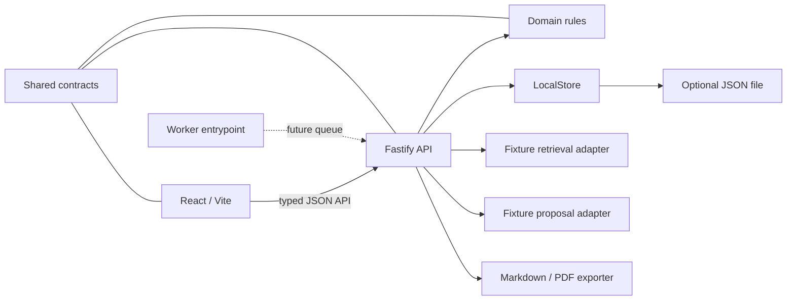

# Architecture

## Design goals

AI Proposal Factory uses a local-first hexagonal design so the complete customer demo can run before Azure provisioning while preserving clean production integration seams.

1. **Product behavior is cloud-independent.** Proposal transitions live in the domain package.
2. **External services are ports.** Persistence, retrieval, generation, export, queue, and clock/ID behavior are interfaces.
3. **Contracts are shared.** The browser, API, tests, and future worker use one typed model.
4. **Human approval is explicit.** Every edit or regeneration creates a new current revision and invalidates that section's prior approval.
5. **Exports are evidence-based.** Only a fully approved proposal can export, and exporters select approved revision IDs.

## Current local topology



`LocalStore` starts with deterministic fixtures and optionally persists one JSON snapshot. Generation advances one stage per status poll, which creates a reliable visible progress experience without timers, remote calls, or nondeterministic tests.

## Domain model

### Proposal states

```text
Draft → Generating → Generated → In Review → Approved
                    ↘ Generation Failed
```

- Generated proposals contain all 12 required sections.
- Editing or regenerating creates a revision and clears `approvedRevisionId` for that section.
- Section approval requires the exact displayed `expectedRevisionId`, checked inside the mutation boundary; stale reviews return 409/412.
- Every generation, edit, regeneration and new section approval changes the opaque proposal `reviewVersion`. Complete approval requires the displayed `expectedReviewVersion` and every current required section's approval.
- Approval retries preserve the original authenticated actor and deterministic audit event. The UI requires explicit refresh after stale-review conflicts and prevents complete approval while an editor is open.
- Export requires `Approved` and uses approved revisions rather than whichever revision happens to be latest.

### Core entities

- `Opportunity`
- `DocumentMetadata`
- `ReusableContent`
- `GenerationRun` and `GenerationStage`
- `Proposal`, `ProposalSection`, and `ProposalSectionRevision`
- `Citation`
- `RiskFinding`
- `AuditEvent`
- `ExportResult`

## Integration ports

The domain package defines:

- `OpportunityRepository`
- `DocumentRepository`
- `ContentRepository`
- `ProposalRepository`
- `GenerationRunRepository`
- `AuditRepository`
- `RetrievalAdapter`
- `ProposalGenerationAdapter`
- `ProposalExporter`
- `Clock`
- `IdGenerator`

The worker package adds `WorkQueue` and `WorkHandler`.

## Azure target mapping

| Local component | Production adapter owner | Azure target |
|---|---|---|
| `LocalStore` opportunity/proposal/audit behavior | Platform | Cosmos DB |
| `LocalStore` document metadata and local upload seam | Platform | Blob Storage |
| Worker `WorkQueue` | Platform | Azure Queue Storage |
| `FixtureRetrievalAdapter` | Intelligence | Azure AI Search |
| `FixtureProposalGenerationAdapter` | Intelligence | Azure OpenAI / Foundry |
| `LocalProposalExporter` | Product/Platform | Worker-hosted export with Blob output |
| Fastify process | Platform | Azure Container Apps or App Service |
| Console/local health | Platform | Application Insights and Azure Monitor |

Adapters should be selected in composition roots (`apps\api\src\server.ts` and the worker entrypoint), not through conditionals inside domain rules or React components.

### Regional convention

- Primary/default Azure location: Sweden Central (`swedencentral`)
- Resource naming region code: `swc`
- Development resource group: `rg-aipf-dev-swc-001`
- No secondary location is configured. A different location may be introduced only when a concrete service or capacity requirement is verified and documented.

The application interfaces do not encode an Azure location. Platform composition and deployment configuration supply the region so local behavior and domain rules remain provider-independent.

### Platform preflight baseline

| Capability | Authoritative default |
|---|---|
| Web/API hosting | Azure Container Apps |
| Background worker | Azure Container Apps, one retained Consumption replica; queue scale-out to three |
| Durable dispatch | Azure Storage Queue |
| Application state | Cosmos DB serverless |
| Retrieval index | Azure AI Search Basic |
| Generation deployment | `proposal-chat` |
| Generation model | `gpt-5.1`, version `2025-11-13`, Standard capacity 50 |
| Embeddings deployment | `proposal-embeddings` |
| Embeddings model | `text-embedding-3-large`, version `1`, Standard capacity 30 |

Cloud composition must obtain service endpoints and Azure OpenAI deployment names from application settings. SDK clients, credentials, model identifiers, and Azure response types remain inside Platform or Intelligence adapters. Domain interfaces continue to exchange only the provider-independent contracts defined in `packages\contracts`.

## API behavior

- Generation is asynchronous from the browser's perspective.
- The API returns a `GenerationRun`; the UI polls its visible stages.
- Local polling advances deterministic work. Azure mode can enqueue work and report persisted progress using the same contract.
- Upload uses bounded multipart intake. Local mode stores private bytes under `.data/uploads`; Azure mode stores them in the private uploads Blob container. Validated extracted text is persisted with metadata and supplied to requirements analysis without exposing Blob SDK types.
- API errors use stable JSON objects. Domain rule violations return conflict responses.
- Review concurrency uses a shared per-opportunity local mutation queue (one process/store), or renewable Cosmos opportunity leases plus conditional proposal ETags in Azure. See `reliability.md` for approval preconditions and recovery evidence.

## Autonomous durable dispatch

The Sweden Central worker deliberately retains one replica, including at zero queue depth. On startup and every 30 seconds while idle, its loop scans persisted undispatched Cosmos jobs before receiving queue messages. A transient scan or queue transport error is logged by code and retried without terminating the consumer. Queue scale-out remains capped at three replicas; no scheduler, new service or second region is introduced.

This trades a continuous 0.5-vCPU/1-GiB allocation and polling operations for the simplest demo recovery topology. A busy worker scans again after its current message finishes; 30 seconds is an idle cadence, not a completion SLA. Durable checkpoints, renewable leases/visibility, retry/poison handling and completion-last publication remain unchanged. See `reliability.md`.

## Retrieval boundary

Local retrieval scores scenario, industry, and problem/tag alignment. It intentionally returns different sources for the five seeded scenarios. The future Azure AI Search adapter must preserve:

- opportunity-aware queries
- stable content IDs
- citation title, type, excerpt, and relevance
- bounded result counts
- no direct Azure SDK types above the adapter

## Testing strategy

- Domain tests verify approval and revision invalidation.
- Fastify injection tests verify opportunity management, retrieval variation, generation, approval enforcement, and both exports.
- React Testing Library verifies core application startup and seeded dashboard rendering.
- All generation and retrieval tests use deterministic fixtures; no live AI calls are allowed in CI.

## Security and operational notes

- End-user access uses Container Apps built-in Entra authentication plus application-enforced single-tenant workspace membership. Managed identity authenticates Azure resource access, not human callers.
- Nginx is the only externally routed listener (8080); the API binds only 127.0.0.1:3001 in the shared replica namespace. The global request gate authorizes all API resources before data access, including global lists, extracted text, audit, and exports.
- Local operation requires explicit non-production development authentication. See `authentication.md` for header trust, CSRF/same-origin policy, user-role bootstrap, audit attribution, and production failure modes.

- No credentials are required or stored.
- `.env` files, local state, dependencies, build output, and coverage are ignored.
- Azure composition should use Managed Identity and least-privilege RBAC.
- Customer document content must move directly to Blob Storage in Azure mode; do not place it in logs or audit metadata.
