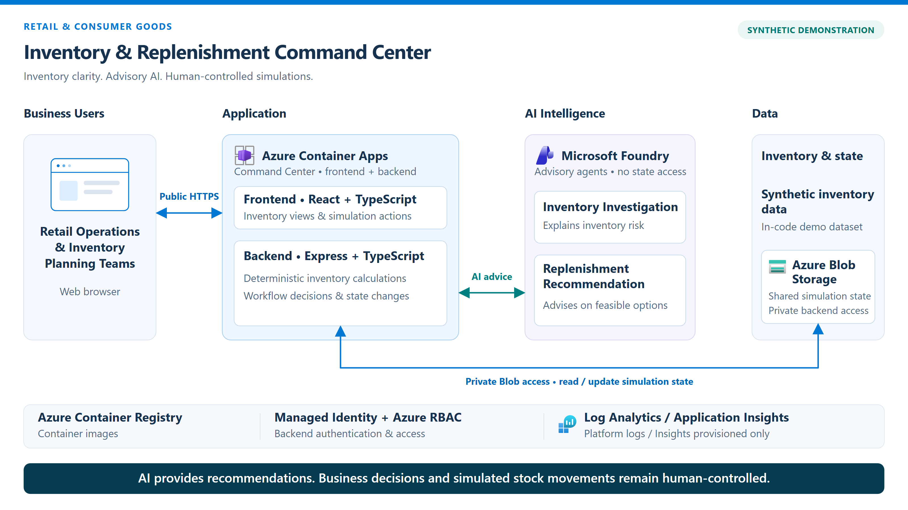
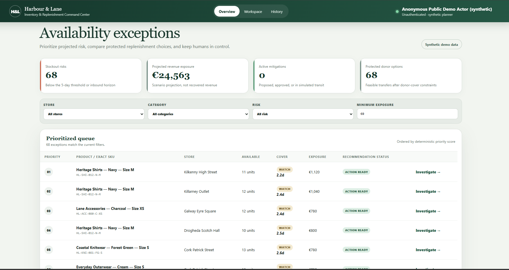

# Retail & Consumer Goods

## Available Demo

### Inventory & Replenishment Command Center

Inventory & Replenishment Command Center helps retail planners understand stock
levels, identify potential stockouts, and compare protected replenishment options.
Using synthetic data for fictional retailer Harbour & Lane, it combines
deterministic inventory calculations with Azure AI through two Microsoft Foundry
agents for evidence-grounded explanations and recommendations.

- **[Open the Inventory & Replenishment Command Center project](./inventory-replenishment-command-center/)**
- **[Open the live application](https://ca-retail-consumer-goods-ne-02.thankfulocean-b1b09e44.norwayeast.azurecontainerapps.io)**
- **[Watch the demo video](./videos/retail-inventory-demo.mp4)**
- **[GitHub Copilot CLI + Squad live demo changes](./inventory-replenishment-command-center/LIVE-DEMO-QUICK-CHANGES.md)**

> Public synthetic demo; no sign-in required. State is shared and resettable.
> AI is advisory, every workflow action is human-initiated and simulated, and no
> operational systems are connected.

## Business Challenge & Solution

Fragmented stock, sales, and delivery information makes inventory decisions slow:
one store can face a stockout while another holds excess stock, and replenishment
can arrive too late or create a shortage at the supplying store.
This demonstration brings inventory evidence and prioritized exceptions into one
workspace, compares replenishment timing, cost, and donor-stock protection, and
uses AI to explain the options before a planner makes a simulated decision.
It illustrates better use of existing stock without claiming measured revenue
recovery or guaranteed availability.

## Key Capabilities

- Prioritized availability exceptions with stockout-risk and projected exposure
  metrics, plus store, category, risk, and minimum-exposure filters.
- Exact size/colour SKU investigation with stock, demand, inbound-delivery, and
  promotion evidence.
- Deterministic comparison of waiting, warehouse replenishment, and store
  transfers, including quantities, arrival times, costs, and donor protection.
- Two Microsoft Foundry agents, **Inventory Investigation** and **Replenishment
  Recommendation**, grounded in supplied evidence and feasible options.
- Human-initiated proposal, approval or rejection, dispatch, and receipt
  simulation for the public Cork-to-Dublin hero transfer; AI is also hero-only.
- Persistent action and audit history, with a shared reset to the starting
  scenario and explicit AI-unavailable states.

Maximum-cover filtering, alternative sorting, CSV export, and comparison badges
are proposed live-demo enhancements, not baseline features.

## Technology Stack

React, Vite, and TypeScript provide the frontend; a Node.js/Express backend hosts
the API and application on Azure Container Apps.
Microsoft Foundry supplies two persisted prompt agents using GPT-4.1 mini.
Azure Blob Storage persists shared state through private networking, with
managed identity and Azure RBAC for service access.
Azure Container Registry, Bicep, and Azure Log Analytics support deployment and
platform logging.

## Built with GitHub Copilot CLI + Squad

GitHub Copilot CLI is a terminal-based AI assistant for software development
using natural-language prompts.
Squad is this project's coordinated team of specialist AI development agents,
distinct from the two Foundry agents used by the application.
Specialists collaborated across frontend, backend, Azure/AI integration, and
validation, with the shared build brief defining scope and handoffs.
Natural-language prompts directed three phases: Azure foundation; application,
Foundry agents, and deployment; then final integration, validation, and packaging.
This approach accelerates solution development while retaining checks, recorded
evidence, and human authorization at each phase boundary.

## Project Resources

- **[Detailed project README](./inventory-replenishment-command-center/README.md)** - Application journey, source layout, and setup.
- **[Architecture documentation](./inventory-replenishment-command-center/docs/ARCHITECTURE.md)** - Components, calculations, and AI boundaries.
- **[Squad build brief](./inventory-replenishment-command-center/RETAIL-INVENTORY-REPLENISHMENT-SQUAD-BRIEF-V1.md)** - Business scenario, phased delivery, and execution history.
- **[Live-demo quick-change instructions](./inventory-replenishment-command-center/LIVE-DEMO-QUICK-CHANGES.md)** - Focused customer-request prompts.
- **[Implementation status](./inventory-replenishment-command-center/STATUS.md)** - Latest deployment and validation evidence.

## Suggested Scenarios

Additional ideas for future solutions, separate from the implemented demo above:

- Store Operations Assistant
- Customer Service Copilot
- Inventory Optimization Agent
- Demand Forecasting Solution
- Product Recommendation Engine
- Loyalty Program Assistant
- E-commerce Support Agent

## Featured Demo — Inventory & Replenishment Command Center

### AI-Assisted Inventory Investigation & Replenishment Planning

Harbour & Lane demonstrates how retail operations teams can identify inventory risks, investigate stock availability, and evaluate replenishment options using deterministic business logic and Microsoft Foundry AI agents.

The solution combines inventory visibility, AI-assisted recommendations, and human-controlled replenishment simulations.

### Solution Architecture

The solution uses Azure Container Apps, Microsoft Foundry, Azure Blob Storage, and supporting Azure infrastructure to deliver an AI-assisted inventory management experience.

### Application Preview

[Explore Project](./inventory-replenishment-command-center/) | [Launch Live Application](https://ca-retail-consumer-goods-ne-02.thankfulocean-b1b09e44.norwayeast.azurecontainerapps.io) | [Watch Demo Video](./videos/retail-inventory-demo.mp4)

---

## Watch the Demo — Inventory & Replenishment Command Center

See how GitHub Copilot CLI and Squad were used to build and deploy an end-to-end retail inventory management application powered by Microsoft Foundry agents.

The demo covers the business scenario, application experience, AI agents, and the development approach.

**[Watch the full demo video](./videos/retail-inventory-demo.mp4)**

https://github.com/user-attachments/assets/ba930ed6-0d68-4621-b200-134da97abf1e

---

## Project Resources

- [Explore the Inventory & Replenishment Command Center](./inventory-replenishment-command-center/)
- [Project README](./inventory-replenishment-command-center/README.md)
- [GitHub Copilot CLI + Squad Live Demo Changes](./inventory-replenishment-command-center/LIVE-DEMO-QUICK-CHANGES.md)

> **Demo disclaimer:** The solution uses synthetic inventory data. AI recommendations are advisory, and all inventory movements are simulated and controlled by users.

